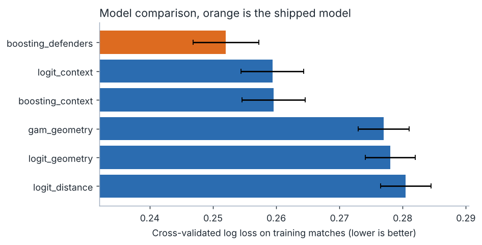
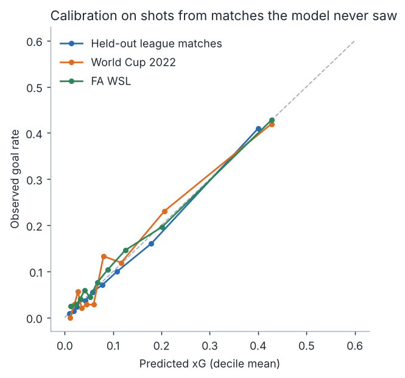
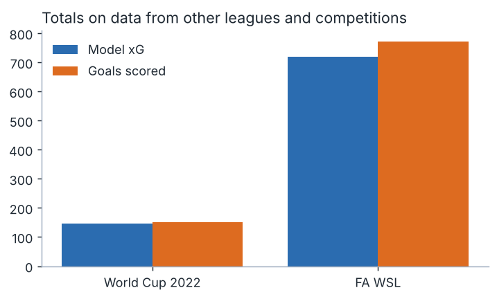
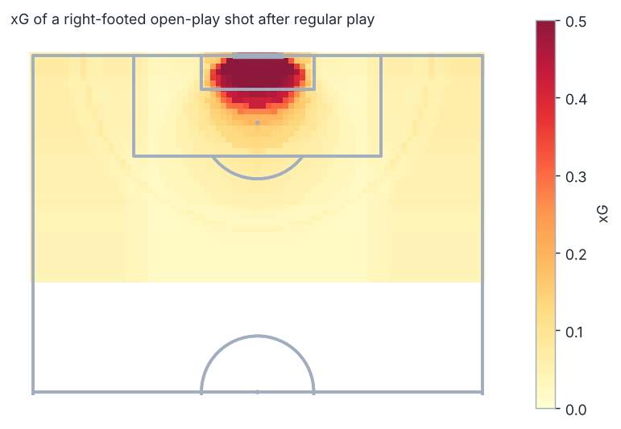
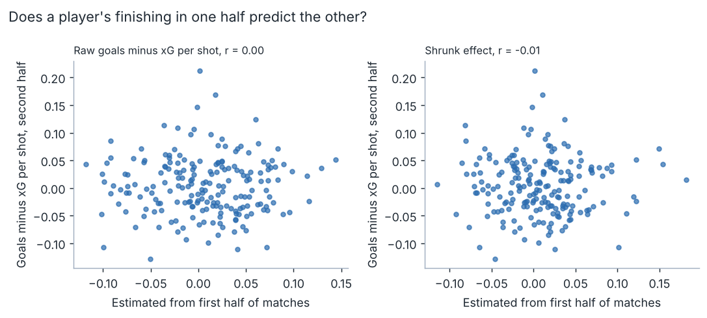
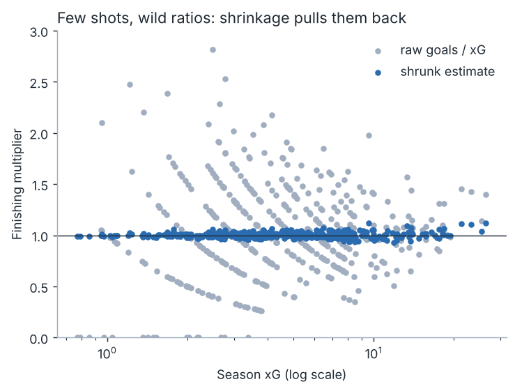

# shotsense

[](https://github.com/ranjithguggilla/shotsense/actions/workflows/ci.yml)

An expected goals (xG) model built to be checked rather than admired. It scores every non-penalty shot from the 2015/16 seasons of four European leagues, validates on whole matches the model never saw, carries the model unchanged to a World Cup and to women's league football, and then uses the scores to ask a question clubs pay real money to answer: is a striker's hot season skill or luck?

The short version of what I found: how the chance was created adds the most after distance and angle, defender and goalkeeper positions at the moment of the shot add a smaller but reliable further gain, the model matches the data provider's own xG on log loss (0.2446 vs 0.2448), and a striker's finishing surplus in one half of a season mostly does not repeat in the next.

## Results

Everything below comes from `outputs/metrics.json`, written by `shotsense run`.

### Model comparison

Data: 37,488 non-penalty shots from 1,517 matches (Premier League, La Liga, Serie A, Ligue 1, 2015/16). I held out 20% of matches (304 matches, 7,555 shots, 694 goals) and compared models by 5-fold cross-validation grouped by match on the other 1,213 matches.

| model | features | CV log loss | test log loss | test Brier | test AUC | test ECE |
|---|---|---|---|---|---|---|
| logit_distance | distance | 0.2805 | 0.2784 | 0.0778 | 0.7315 | 0.0146 |
| logit_geometry | distance, angle | 0.2781 | 0.2758 | 0.0771 | 0.7355 | 0.0154 |
| gam_geometry | smooth distance, angle | 0.2770 | 0.2748 | 0.0769 | 0.7359 | 0.0123 |
| logit_context | + body part, play pattern, assist type, pressure | 0.2594 | 0.2521 | 0.0706 | 0.7945 | 0.0086 |
| boosting_context | same features | 0.2596 | 0.2512 | 0.0709 | 0.8001 | 0.0094 |
| boosting_defenders | + keeper and defender positions | 0.2520 | 0.2446 | 0.0689 | 0.8121 | 0.0064 |

The simplest model within one standard error of the best would have been chosen, but the richest model is clearly ahead: the cross-validation gap to the next candidate is larger than one standard error, so `boosting_defenders` ships. On the test matches its log loss is lower than every alternative, with match-level bootstrap intervals that exclude zero:

| shipped minus other, log loss | difference | 95% interval |
|---|---|---|
| vs distance only | -0.0338 | -0.0394 to -0.0281 |
| vs distance and angle | -0.0312 | -0.0365 to -0.0259 |
| vs smooth distance, angle | -0.0302 | -0.0356 to -0.0249 |
| vs logistic with context | -0.0075 | -0.0111 to -0.0038 |
| vs boosting without defenders | -0.0066 | -0.0095 to -0.0036 |

Test AUC for the shipped model is 0.812 (95% interval 0.798 to 0.827). The data provider's own xG scores 0.2448 log loss and 0.806 AUC on the same shots, so the open model is in the same place. Its calibration is better on this slice (ECE 0.0064 against 0.0137), though the provider's numbers come from a model I did not fit and the comparison is only a sanity check.



Adding keeper and defender positions is a smaller step than adding the context features, but the paired interval says it is not noise. What does not matter much: random-row cross-validation gave 0.2514 and match-grouped gave 0.2520. Shots from the same match are not a serious leak here, but I keep the grouped split anyway because it costs nothing.

### Calibration and transfer

The model was never refit for the next two sets.

| set | shots | goals | model xG | log loss | distance-only log loss | AUC | ECE |
|---|---|---|---|---|---|---|---|
| held-out league matches | 7,555 | 694 | 717.4 | 0.2446 | 0.2784 | 0.812 | 0.0064 |
| World Cup 2022 | 1,430 | 152 | 146.9 | 0.2670 | 0.2998 | 0.815 | 0.0197 |
| FA Women's Super League (2020/21, 2023/24) | 6,718 | 771 | 719.4 | 0.2972 | 0.3294 | 0.777 | 0.0101 |

Totals are within about 7% of goals everywhere, and the model beats the distance-only baseline by a similar margin on both new sets. I also tried a single log-odds shift fitted on half the matches of each new set. It did not help on the other half (World Cup 0.2616 to 0.2622, women's league 0.2979 to 0.2975), so I left recalibration out of the shipped model.





Out-of-fold xG summed over each team's season tracks its goals with a correlation of 0.930 across 82 team seasons (mean absolute gap 4.8 goals).

### Where the chances are



Penalties are not modelled. In this data 362 of 482 were scored, which is 75.1%.

### Game state

Given the same chance quality, teams that trail convert a bit less than expected and teams that lead convert more. Goals divided by out-of-fold xG:

| score when the shot is taken | shots | goals / xG |
|---|---|---|
| down 2 or more | 3,292 | 0.925 |
| down 1 | 7,001 | 0.910 |
| level | 18,301 | 0.981 |
| up 1 | 5,878 | 1.089 |
| up 2 or more | 3,016 | 1.169 |

I did not feed score into the model. There are several plausible explanations, such as teams chasing a game taking more hopeful shots than the features can describe, and I have not tested any of them. I treat it as something the model misses, not as proof of anything psychological.

### Finishing skill

Treating each shot's log-odds as the model's value plus a player effect, the spread of that effect across 426 players with at least 30 shots is tau = 0.115, which means a player one standard deviation above average is about 12% better in odds. That is small next to the noise in a season.

I checked whether it shows up. Players with at least 20 shots in both halves of the season (matches split alternately, 198 players) were scored on the first half and judged on the second:

| estimate from first half | correlation with second-half goals minus xG per shot |
|---|---|
| raw goals minus xG | 0.00 |
| shrunk estimate | -0.01 |



A shortlist of the ten highest first-half raw overperformers had +9.8 goals above xG per 100 shots in that half and +2.5 in the second half, against +0.7 for all players. The shrunk shortlist went from +8.0 to +0.8. Ten players is a small sample and the two shortlists are not distinguishable from each other, but both lost most of their edge.

Ranked by the shrunk estimate, the top five are Luis Suárez (odds multiplier 1.12, 37 goals from 26.4 xG), Gareth Bale (1.12), Zlatan Ibrahimović (1.11), Gonzalo Higuaín (1.11) and Antoine Griezmann (1.09), all with large shot volumes. Ranked by the raw ratio the top is filled with players on 39 to 40 shots who scored six or seven, with raw ratios between 2.4 and 3.4 and shrunk multipliers around 1.06.



### What it is worth

Assumptions are mine and are labelled as such: a goal is worth $1.0M to a club, a striker takes 80 non-penalty shots in a season. A club that paid for the first-half raw shortlist as if the surplus would continue would overpay by (9.8 - 2.5) / 100 x 80 goals x $1.0M, about $5.8M per player-season (bootstrap 95% interval $4.2M to $8.3M over resampled players). At $0.5M per goal that halves, at $2M it doubles. The point is the direction: pay for the shrunk number, not the raw one.

## What it is

shotsense reads shot events from StatsBomb open data, builds a one-row-per-shot table with pre-shot features and a summary of the freeze frame (where the defenders and goalkeeper stood), trains six candidate models, and writes metrics, charts and a scorer you can use from a browser.

## Architecture

```
 StatsBomb open data (git, blobless clone)
            |
            v
   extract.py  --- one row per shot, freeze frame summarised ---> data/shots.csv.gz
            |
            v
   features.py  distance, angle, header, assist type, defenders in cone, keeper depth
            |
            +--> split by match: 80% train / 20% test (league matches)
            |
            v
   models.py  six candidates, preprocessing inside each pipeline
            |
            v
   pipeline.py  grouped CV -> one-SE rule -> test -> transfer -> player study
            |                                              |
            v                                              v
   outputs/metrics.json, model.joblib             players.py  partial pooling
            |
            v
   scoring.py (what-if explanations) --> app.py (Gradio)
```

## Installation

```
git clone https://github.com/ranjithguggilla/shotsense.git
cd shotsense
python -m venv .venv && source .venv/bin/activate
pip install -r requirements.txt
pip install -e . --no-deps
```

Python 3.12 or newer.

## Usage

1. The shot table is committed (`data/shots.csv.gz`, 46,118 shots). To rebuild it from the source repository run `shotsense fetch`. The first run does a blobless clone and streams about 1,800 event files, which takes a while.
2. Run the study: `shotsense run`. This takes roughly half a minute and writes `outputs/` and `assets/`. Add `--quick` for fewer bootstrap draws.
3. Open the scorer: `shotsense app`, then visit the local address Gradio prints.

In code:

```python
import joblib
from shotsense.scoring import ShotInput, explain

bundle = joblib.load("outputs/model.joblib")
print(explain(bundle, ShotInput(x=112, y=36, body_part="Head", play_pattern="From Corner"))["text"])
```

## Configuration

There is no config file. The values that matter are constants at the top of `src/shotsense/pipeline.py`: `SEED` (7), `TEST_SHARE` (0.20) and `VALUE_PER_GOAL` (the $1.0M assumption above). The competitions used are listed in `SELECTION` in `src/shotsense/extract.py`.

## Output structure

```
outputs/
  metrics.json          every number quoted above
  model.joblib          shipped pipeline (ignored by git, rebuilt by CI)
  finishing_table.csv   426 players with raw and shrunk finishing
assets/
  *.png                 charts used in this README
```

## Project structure

```
src/shotsense/
  geometry.py   distance, visible angle, shot cone, freeze-frame summary
  extract.py    open-data reader and shot table builder
  features.py   row-wise features and feature sets
  models.py     candidate pipelines, pyGAM wrapper
  evaluate.py   log loss, ECE, match bootstrap, one-SE rule
  players.py    finishing skill with partial pooling
  scoring.py    single-shot scoring and plain-language reasons
  pipeline.py   the full study
  charts.py     figures
  app.py        Gradio front end
  cli.py        fetch / run / app
tests/          pytest suite
data/           shots.csv.gz
```

## Technical details

Penalties are removed and penalty shootouts are dropped. Shot location uses the 120 by 80 pitch of the event data. Features that exist only after the ball leaves the foot (end location, outcome, deflection) are excluded; the freeze frame is recorded at the instant of the shot, so it is allowed. Missing values are imputed with the training median inside each pipeline, and categories seen fewer than 20 times are pooled.

The test set is 20% of league matches chosen at random by match id, and cross-validation uses `GroupKFold` on match id, so no match contributes to both sides. Model choice uses the one-standard-error rule on paired fold differences, ordered from simplest to richest. Uncertainty on test metrics comes from bootstrapping whole matches.

The finishing model puts a normal prior on a log-odds shift per player and evaluates the marginal likelihood on a grid, with tau chosen by maximum likelihood. Player xG comes from out-of-fold predictions so a player's own shots never helped score him.

Explanations for a single shot swap one factor at a time to that of a typical chance and report the change in xG, which works for both the additive and boosted models.

Known limits: one season of league data per competition, a single random test split, a pooled model across positions, and 2015/16 tactical conditions. The $1.0M-per-goal figure is an assumption, not a measurement.

## Testing

```
ruff check .
pytest --cov=shotsense
```

38 tests, 88% line coverage. They cover the geometry, the event parser (on synthetic events), the metrics and bootstrap, recovery of a known player spread on simulated data, every candidate model, the scoring function behind the app, and the pipeline end to end on a match-level subsample. CI runs lint and tests on every push and pull request, and on main it retrains and uploads the model and metrics as an artifact.

## Dataset

Shot events come from the StatsBomb open data repository, https://github.com/statsbomb/open-data, used under their open data terms. Please credit StatsBomb if you publish work built on it. Competitions used: Premier League, La Liga, Serie A and Ligue 1 2015/16; FIFA World Cup 2022; FA Women's Super League 2020/21 and 2023/24.

## License

MIT, see `LICENSE`.
